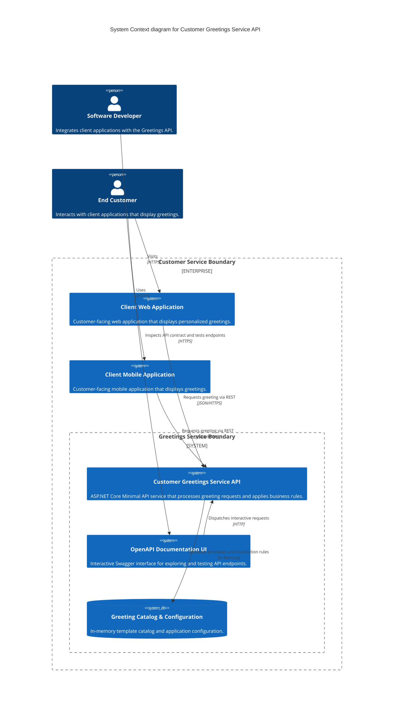

# Customer Greetings Service API — Architecture

## System Diagram



## Tech Stack

- **Runtime & Language:** .NET 10, C# 13.
- **Web Framework:** ASP.NET Core Minimal APIs.
- **API Documentation:** Microsoft.AspNetCore.OpenApi, Swashbuckle / Scalar OpenAPI UI.
- **Validation:** FluentValidation / DataAnnotations.
- **Testing:** xUnit, FluentAssertions, Microsoft.AspNetCore.Mvc.Testing (WebApplicationFactory).
- **Diagnostics & Observability:** System.Diagnostics.Activity, OpenTelemetry, Microsoft.Extensions.Logging.

## Layers

The application uses a lightweight layered architecture:

- **Presentation Layer (Endpoints):**
  - Defines HTTP route handlers using ASP.NET Core Minimal APIs.
  - Maps incoming HTTP query parameters and request bodies to request models.
  - Configures OpenAPI endpoint metadata, summary tags, and status code responses.
- **Application Layer (Services & Logic):**
  - Contains greeting generation workflow logic.
  - Selects appropriate greeting formats based on customer name, time of day, and language locale.
  - Implements validation rules for client input.
- **Domain Layer (Entities & Rules):**
  - Contains core greeting entity models, greeting formats, and value objects.
  - Defines supported locales (such as `en-GB`, `en-US`, `es-ES`, `fr-FR`).
  - Defines time period classifications (Morning, Afternoon, Evening, Night).
- **Infrastructure Layer (Data & Configuration):**
  - Implements the in-memory greeting template provider.
  - Loads configuration settings and template overrides from `appsettings.json`.

## Key Patterns

- **Minimal APIs Pattern:** Endpoints are registered cleanly using extension methods without controller boilerplate.
- **Repository / Provider Pattern:** An abstraction `IGreetingTemplateProvider` separates greeting message storage from business logic.
- **Result Pattern:** Business services return explicit result objects that encapsulate success data or error reasons.
- **Dependency Injection:** Services, options, and providers are registered in the built-in Microsoft DI container.

## Source code layout

```text
src/
  CustomerGreetings.Api/
    Program.cs                 # Application bootstrapper and DI registration
    appsettings.json           # Application configuration and template definitions
    Endpoints/                 # Route handler registrations
      GreetingEndpoints.cs     # GET /api/v1/greetings endpoint mappings
      HealthEndpoints.cs       # GET /health endpoints
      HelloWorldEndpoints.cs   # GET /hello-world diagnostic endpoints
    Domain/                    # Domain models and value objects
      GreetingResponse.cs      # Core greeting DTO
      TimeOfDayPeriod.cs       # Time interval enum/rule
    Services/                  # Business logic services
      IGreetingService.cs      # Service interface
      GreetingService.cs       # Greeting construction logic
    Infrastructure/            # Template providers and data access
      IGreetingTemplateProvider.cs
      InMemoryGreetingTemplateProvider.cs
tests/
  CustomerGreetings.Api.Tests.Unit/          # xUnit unit test project
  CustomerGreetings.Api.Tests.Integration/   # WebApplicationFactory integration test project
```

## Data Flow

1. The client sends an HTTP `GET /api/v1/greetings` request with query parameters (e.g., `name`, `locale`, `time`).
2. The route handler validates input parameters.
3. The greeting service identifies the customer name and determines the time-of-day period.
4. The service queries the template provider for matching locale and time templates.
5. The service formats the final personalized greeting text.
6. The endpoint returns a JSON response containing the greeting message, locale, and UTC timestamp with HTTP status code 200.

## Cross-Cutting Concerns

- **Error Handling:** Standardized Problem Details (RFC 7807) for error responses.
- **Security:** Input sanitization to prevent injection; request rate limiting; no personal customer identifiers in persistent logs.
- **Observability:** Structured logging with correlation IDs on all incoming requests; health check endpoints for container orchestrators.
- **OpenAPI / Swagger:** Auto-generated API documentation available at `/swagger` or `/openapi`.

## ADRs

<!-- adr-table:start -->
| ID | Title | Status | Date |
|----|-------|--------|------|
| [ADR-0001](decisions/ADR-0001-adopt-aspnet-core-minimal-apis.md) | Adopt ASP.NET Core Minimal APIs for Customer Greetings Service API | accepted | 2026-11-11 |
| [ADR-0002](decisions/ADR-0002-static-hello-world-endpoint.md) | Static Hello World Endpoint | accepted | 2026-11-12 |
| [ADR-0003](decisions/ADR-0003-static-hello-world-endpoint.md) | Static Hello World Endpoint | accepted | 2026-11-12 |
<!-- adr-table:end -->

## Assumptions

<!-- assumption-list:start -->
- [ASSUME-0001](assumptions/ASSUME-0001-dotnet-tech-stack.md): Use .NET 10 and ASP.NET Core Minimal APIs (validated)
- [ASSUME-0002](assumptions/ASSUME-0002-in-memory-template-storage.md): In-Memory and Configuration Greeting Template Storage for Alpha (unresolved)
- [ASSUME-0003](assumptions/ASSUME-0003-hello-world-static.md): Hello-World Endpoint is Static (validated)
<!-- assumption-list:end -->

The save_adr and save_assumption tools fill these lists. Do not edit between the markers.

## Knowledge Base

- [KB-0001](knowledge/KB-0001-greeting-generation-rules.md): Greeting Generation and Time-of-Day Calculation Rules
- [KB-0002](knowledge/KB-0002-value-rule-set.md): Organizational Value Definition and Rule Set
- [KB-0005](knowledge/KB-0005-resolve-openapi-vulnerability-dotnet10.md): Resolve Microsoft.OpenApi Vulnerability GHSA-v5pm-xwqc-g5wc in .NET 10
- [KB-0006](knowledge/KB-0006-static-diagnostic-endpoint-pattern.md): Static Diagnostic Endpoint Implementation Pattern
